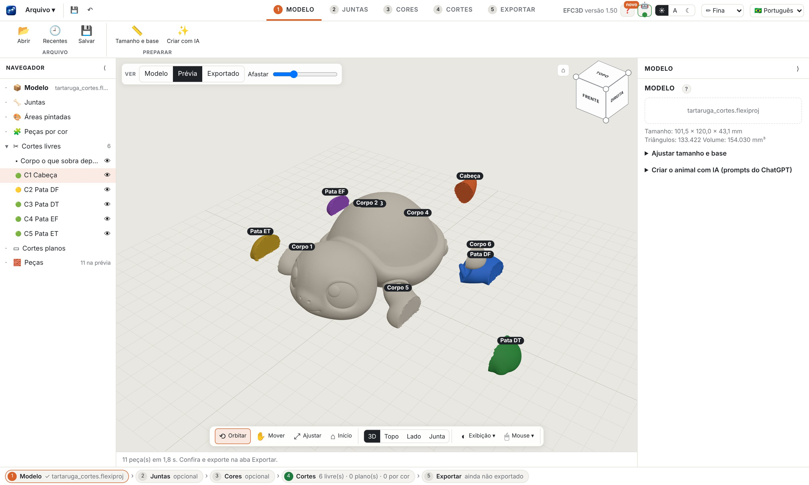
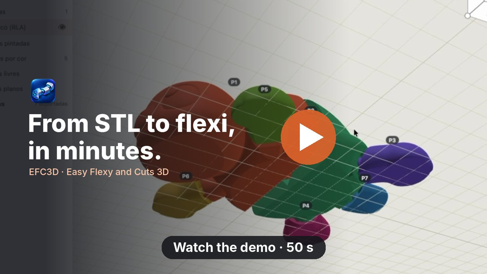
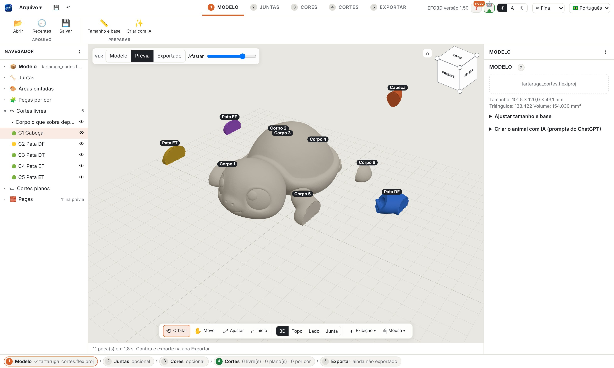

<h1 align="center">EFC3D</h1>

<b>Easy Flexy and Cuts 3D</b>

<a href="README.md">Português</a> · <b>English</b> · <a href="README.es.md">Español</a>

  
  
  

Turn any 3D model into an <b>articulated flexi</b> or into <b>parts that fit together</b>, ready to print. 
For Mac and Windows · 100% on your computer · no account and no subscription.

  <a href="../../releases/latest"><b>⬇ Download the latest version</b></a> ·
  <a href="https://github.com/sponsors/robertoaran79-pixel"><b>♥ Support the project</b></a>

## See it in 1 minute

Click the image to watch. Vertical version (Reels/Shorts): <a href="docs/video/efc3d_demo_en_9x16.mp4?raw=true">efc3d_demo_en_9x16.mp4</a>

## What it does
- **Print-in-place joints:** click where the model should bend. The app fits the joint, checks strength, clearance and skin, and shows a light on each one.
- **Free cut along the skin:** draw a line on the model and get the piece. The outer shape does not change, the piece comes out in the fit direction the app suggests, and it can take a pin, a socket or a manual connector.
- **Split by color:** paint with brush, bucket or height band and turn each area into a fitting part (eyes, hair, clothes), to print each color without an AMS.
- **Plane cut** with connector, like in the slicer, for large models.
- **Ready export:** multicolor 3MF, STLs and plates already arranged on your printer's bed, each part in its best position.
- Português, English and Español. Full help inside the app.

## Downloads
| System | File |
|---|---|
| macOS 11 or newer, Apple Silicon | `EFC3D-<version>-mac-apple-silicon.dmg` |
| macOS 11 or newer, Intel | `EFC3D-<version>-mac-intel.dmg` |
| Windows 10 and 11 (64-bit) | `EFC3D-<version>-windows-instalador.exe` |

All of them are in [Releases](../../releases). The change history is in the [CHANGELOG](CHANGELOG.md).

### First launch
- **Mac:** open the .dmg and drag EFC3D to Applications. The app is not notarized by Apple yet, so macOS blocks it the first time. Right click EFC3D › Open. If that option does not show, go to System Settings › Privacy & Security and click **Open Anyway**.
- **Windows:** if SmartScreen warns you, click **More info › Run anyway**.
- **Joints on very thin parts** (legs of small models) may turn red: scale the model up, use the Low Arch or import a cut piece you have the right to use.

## Support EFC3D
EFC3D is free for personal and noncommercial use, built by one person in their spare time. If it saved you time or gave you a nice flexi, please consider [sponsoring it on GitHub Sponsors](https://github.com/sponsors/robertoaran79-pixel). Any amount helps, monthly or one time, and 100% goes to the developer (GitHub charges no fee for sponsorships from personal accounts).

What sponsorship pays for, in this order:
- **Signed and notarized app** on Mac and Windows, with no security warning on first launch.
- **A smaller own joint** for thin parts (legs of small models).
- **Free cut with no sheet at the base** when the line goes down to the bed.
- Time to answer bug reports and ship releases often.

It also helps a lot, for free: star the repository, share your prints made with EFC3D and [report problems](../../issues).

### Sponsors
Thank you to everyone who supports the project. Sponsors are listed here (with your permission, at the tier you choose). Be the first!

## License
[PolyForm Noncommercial 1.0.0](LICENSE): free to use, study and modify for noncommercial purposes. Commercial use needs permission. The own joints (RLA) are part of the project and follow the same license. Third-party libraries: [notices](AVISOS_DE_TERCEIROS.md).
