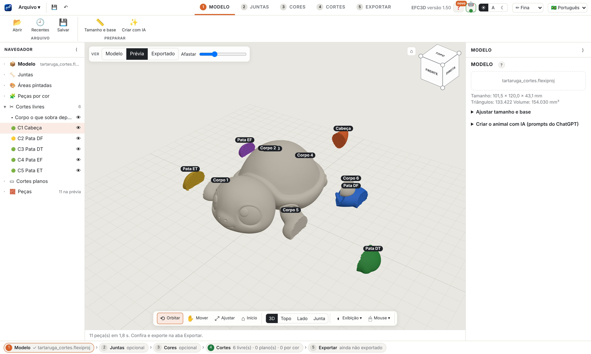
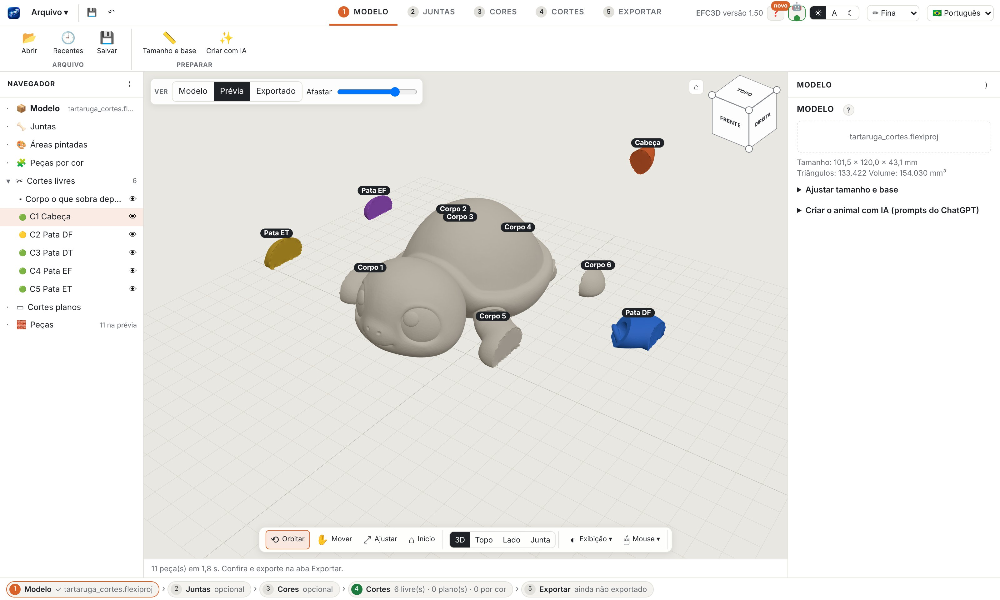

<h1 align="center">EFC3D</h1>

<b>Easy Flexy and Cuts 3D</b>

<a href="README.md">Português</a> · <a href="README.en.md">English</a> · <b>Español</b>

Convierte cualquier modelo 3D en un <b>flexi articulado</b> o en <b>piezas que encajan</b>, listas para imprimir. 
Para Mac y Windows · 100% en tu computadora · sin cuenta y sin suscripción.

  <a href="../../releases/latest"><b>⬇ Descargar la última versión</b></a> ·
  <a href="https://github.com/sponsors/robertoaran79-pixel"><b>♥ Apoyar el proyecto</b></a>

## Qué hace
- **Juntas que se imprimen listas (print in place):** haz clic donde el modelo debe doblarse. La app ajusta la junta, revisa fuerza, holgura y piel, y muestra una luz en cada una.
- **Corte libre por la piel:** dibuja una línea en el modelo y recibe la pieza. La forma exterior no cambia, la pieza sale en la dirección de encaje que sugiere la app y puede llevar pasador, encaje o conector manual.
- **Separar por color:** pinta con pincel, cubo o franja de altura y convierte cada área en una pieza que encaja (ojos, pelo, ropa), para imprimir cada color sin AMS.
- **Corte plano** con conector, como en el laminador, para modelos grandes.
- **Exportación lista:** 3MF multicolor, STLs y placas ya ordenadas en la cama de tu impresora, cada pieza en su mejor posición.
- Português, English y Español. Ayuda completa dentro de la app.

## Descargas
| Sistema | Archivo |
|---|---|
| macOS 11 o más nuevo, Apple Silicon | `EFC3D-<versión>-mac-apple-silicon.dmg` |
| macOS 11 o más nuevo, Intel | `EFC3D-<versión>-mac-intel.dmg` |
| Windows 10 y 11 (64 bits) | `EFC3D-<versión>-windows-instalador.exe` |

Todos están en [Versiones](../../releases). El historial de cambios está en el [CHANGELOG](CHANGELOG.md).

## Apoya
EFC3D es gratuito para uso personal y sin fines comerciales. Si te fue útil, [apóyalo en GitHub Sponsors](https://github.com/sponsors/robertoaran79-pixel): eso es lo que mantiene el proyecto en marcha.

## Licencia
[PolyForm Noncommercial 1.0.0](LICENSE): uso, estudio y modificación libres con fines no comerciales. El uso comercial necesita autorización. Las juntas propias (RLA) son parte del proyecto y siguen la misma licencia. Bibliotecas de terceros: [avisos](AVISOS_DE_TERCEIROS.md).
