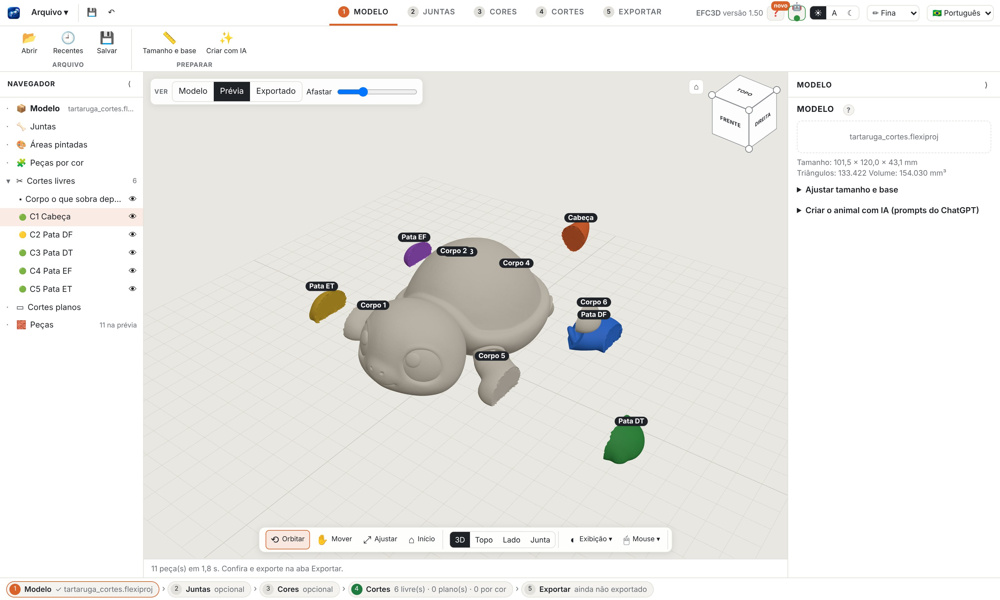
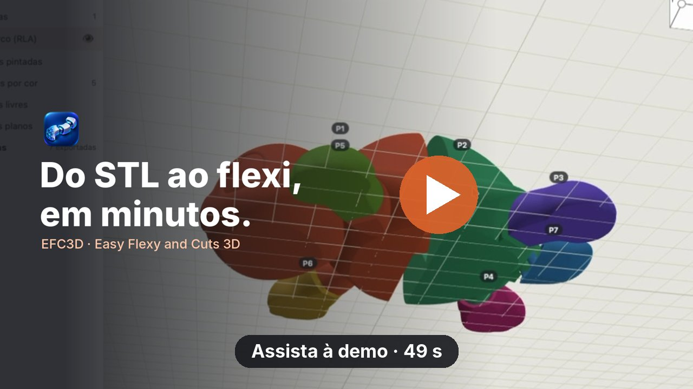
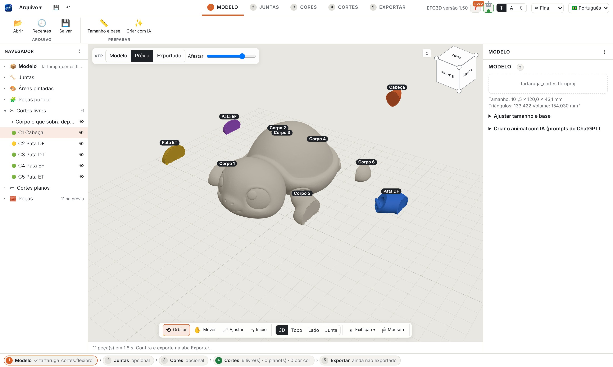

<h1 align="center">EFC3D</h1>

<b>Easy Flexy and Cuts 3D</b>

<b>Português</b> · <a href="README.en.md">English</a> · <a href="README.es.md">Español</a>

  
  
  

Transforme qualquer modelo 3D em um <b>flexi articulado</b> ou em <b>peças que encaixam</b>, prontas para imprimir. 
Para Mac e Windows · 100% no seu computador · sem conta e sem assinatura.

  <a href="../../releases/latest"><b>⬇ Baixar a última versão</b></a> ·
  <a href="https://github.com/sponsors/robertoaran79-pixel"><b>♥ Apoiar o projeto</b></a>

## Veja em 1 minuto

Clique na imagem para assistir. Versão vertical (Reels/Shorts): <a href="docs/video/efc3d_demo_pt_9x16.mp4?raw=true">efc3d_demo_pt_9x16.mp4</a>

## O que ele faz
- **Juntas que imprimem prontas (print in place):** clique onde o modelo deve dobrar. O app encaixa a junta, confere força, folga e pele e mostra um semáforo em cada uma.
- **Corte livre pela pele:** desenhe uma linha no modelo e receba a peça. A forma de fora não muda, a peça sai na direção de encaixe que o app sugere e pode levar pino, soquete ou conector manual.
- **Separar por cor:** pinte com pincel, balde ou faixa de altura e transforme cada área em peça de encaixe (olhos, cabelo, roupa), para imprimir cada cor sem AMS.
- **Corte plano** com conector, como no fatiador, para modelos grandes.
- **Exportação pronta:** 3MF multicor, STLs e placas já arrumadas na mesa da sua impressora, cada peça na melhor posição.
- Português, English e Español. Ajuda completa dentro do app.

## Downloads
| Sistema | Arquivo |
|---|---|
| macOS 11 ou mais novo, Apple Silicon | `EFC3D-<versão>-mac-apple-silicon.dmg` |
| macOS 11 ou mais novo, Intel | `EFC3D-<versão>-mac-intel.dmg` |
| Windows 10 e 11 (64 bits) | `EFC3D-<versão>-windows-instalador.exe` |

Todos ficam em [Versões](../../releases). O histórico de mudanças está no [CHANGELOG](CHANGELOG.md).

### Primeira abertura
- **Mac:** abra o .dmg e arraste o EFC3D para Aplicativos. O app ainda não é notarizado pela Apple, então na primeira vez o macOS bloqueia. Clique com o botão direito no EFC3D › Abrir. Se não aparecer a opção, vá em Ajustes do Sistema › Privacidade e Segurança e clique em **Abrir Mesmo Assim**.
- **Windows:** se o SmartScreen avisar, clique em **Mais informações › Executar assim mesmo**.
- **Juntas em partes muito finas** (patas de modelos pequenos) podem ficar vermelhas: aumente o modelo, use o Arco Baixo ou importe uma peça de corte que você tenha o direito de usar.

## Apoie o EFC3D
O EFC3D é gratuito para uso pessoal e sem fins comerciais, feito por uma pessoa só, nas horas vagas. Se ele te poupou tempo ou rendeu um flexi bonito, considere [patrocinar pelo GitHub Sponsors](https://github.com/sponsors/robertoaran79-pixel). Qualquer valor ajuda, mensal ou de uma vez só, e 100% vai para o desenvolvedor (o GitHub não cobra taxa de quem patrocina com conta pessoal).

O que o patrocínio paga, nesta ordem:
- **App assinado e notarizado** no Mac e no Windows, sem o aviso de segurança na primeira abertura.
- **Junta própria menor** para partes finas (patas de modelos pequenos).
- **Corte livre sem lâmina na base** quando a linha desce até a mesa.
- Tempo para responder relatos de problema e lançar versões com frequência.

Também ajuda muito, sem custo: dar uma ⭐ no repositório, mostrar suas impressões com o EFC3D e [relatar problemas](../../issues).

### Patrocinadores
Obrigado a quem apoia o projeto. Os patrocinadores aparecem aqui (com a sua permissão, no nível que você escolher). Seja o primeiro!

## Licença
[PolyForm Noncommercial 1.0.0](LICENSE): uso, estudo e modificação livres para fins não comerciais. Uso comercial precisa de autorização. As juntas próprias (RLA) fazem parte do projeto e seguem a mesma licença. Bibliotecas de terceiros: [avisos](AVISOS_DE_TERCEIROS.md).
